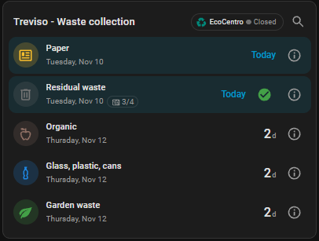
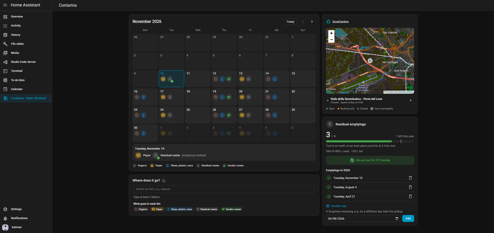
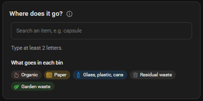
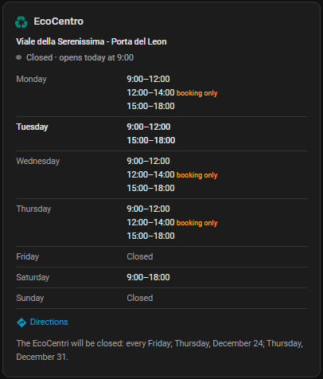

# Contarina for Home Assistant

[](https://hacs.xyz)
[](https://github.com/kiren0494/ha-contarina/actions/workflows/validate.yml)

Waste collection calendars of [Contarina](https://contarina.it) (province of Treviso, Italy)
in Home Assistant: one sensor per waste type with the days left until the next pickup, an
optional counter of residual bin emptyings against the yearly allowance, and a Lovelace card.



> **Disclaimer:** this is an unofficial project, not affiliated with or endorsed by
> Contarina S.p.A. It reads the public calendars published on contarina.it.

## Features

- All the municipalities served by Contarina (including the zones of Treviso, Asolo,
  Castelfranco Veneto and Montebelluna).
- One sensor per waste type: organic, paper, glass/plastic/cans, residual, garden waste.
- Several calendars side by side (e.g. home and a second house), each with its own name.
- Optional tracking of residual bin emptyings, with the yearly allowance
  (household members + 1 emptyings of 120 L).
- EcoCentro opening hours: whether the municipality's EcoCentro is open now, its weekly
  hours and directions, also from a button on the card.
- "Where does it go?": search the Contarina waste dictionary from the card or an action,
  in Italian or English (updated daily from contarina.it).
- One-off reminders: tap a pickup to get a notification (e.g. the evening before) on your
  phone or in Home Assistant.
- An optional **Contarina** page in the sidebar, whose entry can show tomorrow's pickups.
- A Lovelace card, loaded automatically, with a "what goes in each bin" guide.
- English and Italian translations.

## Installation

### Marketplace (Home Assistant 2026.11 and later)

[](https://my.home-assistant.io/redirect/marketplace_repository/?owner=kiren0494&repository=ha-contarina&category=integration)

1. Click the button above, or go to **Settings → Marketplace → Add from link** and enter
   `kiren0494/ha-contarina`.
2. Download **Contarina** and restart Home Assistant.

### HACS (before Home Assistant 2026.11)

1. In HACS, open the menu ⋮ → **Custom repositories**, add
   `https://github.com/kiren0494/ha-contarina` with type **Integration**.
2. Search for **Contarina**, download it and restart Home Assistant.

### Manual

Copy `custom_components/contarina` into the `custom_components` folder of your Home
Assistant configuration and restart.

## Configuration

**Settings → Devices & services → Add integration → Contarina**, then fill in:

| Field | Description |
|---|---|
| Municipality | Your municipality (or zone, for the larger towns): type to search it. |
| Name | Optional: replaces the municipality name in the sensors (e.g. "Home"). |
| EcoCentro opening hours | On by default: adds the EcoCentro sensor. |
| Create a pickups calendar | Optional: adds a calendar entity with the pickups. |
| Set up the optional features | Tick it to go on to the pages below; otherwise they keep their defaults. |

The optional pages, one after the other:

| Page | Field | Description |
|---|---|---|
| Residual bin emptyings | Household members | Enables counting the residual bin emptyings. |
| | Residual waste bin size | Liters, default 120. |
| Sidebar | Show the Contarina page | Adds a **Contarina** page to the sidebar (see below). |
| | Show tomorrow's pickups in the sidebar | The sidebar entry becomes e.g. "Contarina · Organic, Paper" the day before a pickup. |
| Pickup reminders | Days before the pickup, Time, Send to | How the reminder popup opens (default 1 day before at 20:00, the device last used). With 0 days the time can be at the latest 6:00. |

Add the integration again for each extra calendar. Everything but the municipality and the
name can be changed later from **Configure**, which opens a menu with the same groups
(*EcoCentro and calendar* plus the three pages above); leaving the household members empty
turns the counter off.

## Entities

Each calendar is a device named `Contarina <name>` with these sensors

| Sensor | State | Attributes |
|---|---|---|
| Organic, Paper, Glass/plastic/cans, Residual, Garden waste | Days until the next pickup (0 = today) | `next_date`, `waste`, `location`, `municipality_name` |
| Next pickup | Waste types of the next pickup, e.g. `Organic, Glass/plastic/cans` | `next_date`, `days`, `waste_types` |
| Residual emptyings *(optional)* | Emptyings marked this year | `emptyings_total`, `expected_by_now`, `liters_used`, `liters_total`, `dates` |
| EcoCentro *(optional)* | `open`, `booking_only` or `closed` | `address`, `opening_hours`, `open_until`, `next_opening`, `holidays`, `notice`, `closures`, `latitude`, `longitude` |

and, if **Create a pickups calendar** is ticked (during setup or later from **Configure**),
a **Pickups** calendar entity (`calendar.contarina_<name>_pickups`): one all-day event
per pickup day, titled with the waste types (e.g. `Organic, Paper`), shown in the Home
Assistant calendar and usable with calendar triggers. It starts from today: the calendars
published by Contarina don't include past pickups.

The calendar is downloaded once a day; if contarina.it is unreachable the last copy is used.

### EcoCentro

The opening hours are read once a day from the
[EcoCentri page](https://contarina.it/cittadino/raccolta-differenziata/ecocentro/orari-ecocentro)
of contarina.it. The sensor changes state exactly when a time slot starts or ends;
`booking_only` means the centre is open only to those who booked. Municipalities with two
centres (Castelfranco Veneto, Montebelluna, Pieve del Grappa) get one sensor each, named after
the address. On Italian national holidays (Easter Monday included) the sensor is `closed`.
Other closures (e.g. 24 and 31 December) are announced by Contarina in a sentence above the
opening hours, in Italian: it's kept in the `notice` attribute and read into dates in the
`closures` attribute, so the sensor is `closed` on those days (or half days) too and the card
writes the notice in your language. A sentence the integration can't fully read is shown as
it is, in Italian, and doesn't change the state. Local patron saints aren't published, so
they aren't known.

### Next pickup and reminders

On a pickup day the **Next pickup** sensor moves on to the following pickup at midday, so
in the evening it already tells what to put out for tomorrow. A reminder the evening before:

```yaml
automation:
  - alias: Contarina reminder
    triggers:
      - trigger: time
        at: "20:00:00"
    conditions:
      - condition: template
        value_template: "{{ state_attr('sensor.contarina_home_next_pickup', 'days') == 1 }}"
    actions:
      - action: notify.notify
        data:
          title: Waste collection
          message: "Put out tonight: {{ states('sensor.contarina_home_next_pickup') }}"
```

The waste names follow the Home Assistant language (in Italian: `Umido, VPL`); after
changing the language, reload the integration.

### Residual bin emptyings

Contarina includes (household members + 1) emptyings of a 120 L bin per year in the fixed
fee. The allowance is a volume: with a 60 L bin you get twice as many emptyings.
`expected_by_now` is where an even pace through the year would be today. The count restarts
on January 1st.

Mark emptyings from the card or with the actions:

```yaml
action: contarina.add_emptying        # date is optional, default today
target:
  entity_id: sensor.contarina_home_residual_emptyings
data:
  date: "2026-11-04"
```

```yaml
action: contarina.remove_emptying
target:
  entity_id: sensor.contarina_home_residual_emptyings
data:
  date: "2026-11-04"
```

### Pickup reminders

Tap a pickup on the card (or a waste icon in the month view of the sidebar page) to set a
one-off reminder for it: by default the evening before at 20:00 (change it in the *Pickup
reminders* page of **Configure**), at the latest 6:00 on the pickup day. The
notification goes to the device you pick (any `notify` service, e.g. the Companion app's
`mobile_app_<device>`, listed by device name) or to the Home Assistant notifications. A
bell on the card and on the page shows the reminders set. The same with actions:

```yaml
action: contarina.add_reminder
target:
  entity_id: sensor.contarina_home_garden_waste
data:
  date: "2026-09-20"          # pickup day, optional: default the next one
  at: "2026-09-19 20:00:00"   # optional: default from the integration's settings
  notify: mobile_app_my_phone # optional: default from the integration's settings;
                              # empty = the Home Assistant notifications
```

`contarina.remove_reminder` with the pickup `date` removes it. A reminder missed while Home
Assistant was off is sent right after the restart, if the pickup isn't over yet.

### Where does it go?

The `contarina.search_waste` action searches the Contarina waste dictionary (the same as
the search box on contarina.it, about 300 items) and returns the container of each
matching item. The card has a search button that uses it.

How it works:

- The dictionary is **downloaded from contarina.it once a day** (at the first search of the
  day) and saved in Home Assistant, so searching is instant and still works for a while
  if the site is down. The card says when it was last updated (normally "today").
- contarina.it publishes it **in Italian only**. The integration ships an **English
  translation** of every item, used when Home Assistant (or the `language` field) isn't
  Italian; then both English and Italian words are found ("battery" or "pile"). An item
  that Contarina adds or renames after the translation was made stays in Italian until
  the next release of the integration.
- Case, accents and singular/plural endings are ignored ("bottiglia" finds "Bottiglie").

```yaml
action: contarina.search_waste
data:
  query: capsule
  language: en      # optional, default: the Home Assistant language
response_variable: result
# result.results: [{name: "Compostable coffee capsules and pods",
#                   name_it: "Capsule e cialde compostabili per macchinette del caffè",
#                   containers: [{name: "Umido", type: "organic"}]}, ...]
# result.updated: when the dictionary was downloaded (ISO date and time)
```

`type` is one of the waste types (`organic`, `paper`, `glass`, `residual`, `garden`),
`ecocenter`, a special collection (`batteries`, `medicines`, `clothes`, `toner`,
`small_appliances`, `special_service`) or empty for anything new. Container `name` is
the Italian one from contarina.it; the card shows its own translated names.

## Sidebar page

Tick **Show the Contarina page** on the *Sidebar* page (during setup or from
**Configure**) to get a **Contarina** page in the sidebar, with a tab for each calendar:

- a month view of the pickups (tap a day for the details, a waste icon to set a reminder;
  a tick marks the residual emptyings you marked);
- a map of all the EcoCentri, colored by open/closed: tap one to see its opening hours;
- the residual emptyings counter (if not tracked, how to turn it on);
- the "Where does it go?" search with the bins' guides.



The page is shared by all the calendars: it's shown as long as at least one of them has the
option on. Each user can still hide it from their own sidebar.

With **Show tomorrow's pickups in the sidebar**, from the day before a pickup until midday
of the pickup day the sidebar entry reads e.g. "Contarina · Organic, Paper", with the
waste's icon (a generic one for several types). The sidebar only allows one icon and some
text per entry.

## Notification blueprints

Ready-made automations, set up from menus without writing YAML. Click a button to import
the blueprint, then create an automation from it and pick your Contarina calendar and your
phone (the [Companion app](https://companion.home-assistant.io/) is needed for the
notifications).

| Blueprint | What it does | |
|---|---|---|
| Pickup reminder | The evening before (or the morning of) a pickup, sends e.g. "Put out: Organic, Paper". You can choose the time and limit it to some waste types. | [](https://my.home-assistant.io/redirect/blueprint_import/?blueprint_url=https%3A%2F%2Fgithub.com%2Fkiren0494%2Fha-contarina%2Fblob%2Fmain%2Fblueprints%2Fautomation%2Fcontarina%2Fpickup_reminder.yaml) |
| Residual bin emptying | The evening before the residual pickup, asks whether you are putting the bin out; tapping **Yes** marks the emptying. Needs the emptyings counter turned on. | [](https://my.home-assistant.io/redirect/blueprint_import/?blueprint_url=https%3A%2F%2Fgithub.com%2Fkiren0494%2Fha-contarina%2Fblob%2Fmain%2Fblueprints%2Fautomation%2Fcontarina%2Fresidual_emptying.yaml) |

The texts of the notifications can be changed in the blueprint settings.

## Lovelace card

The card is registered automatically: add a **Contarina card** from the dashboard editor,
or in YAML:

```yaml
type: custom:contarina-card
```

It comes in three layouts, chosen in **Content** in the visual editor (or `view:` in YAML):

<table>
  <tr>
    <th>Pickups (default)</th>
    <th>Search: <code>view: search</code></th>
    <th>EcoCentro: <code>view: ecocenter</code></th>
  </tr>
  <tr valign="top">
    <td></td>
    <td></td>
    <td></td>
  </tr>
  <tr valign="top">
    <td>Days to each pickup, emptyings counter, reminders; buttons for the EcoCentro and the search.</td>
    <td>"Where does it go?" always open, with the guide of each bin.</td>
    <td>Status and weekly opening hours of the municipality's EcoCentro, with closures.</td>
  </tr>
</table>

All options are optional:

```yaml
type: custom:contarina-card
title: Bins at {location} # replaces the whole header; {location} = calendar name
location: Home            # only show the calendar with this name (or municipality)
soon_days: 1              # default limit, in days, for the types set to "soon"
hide_when_empty: true     # hide the card when nothing is shown
ecocenter: false          # hide the EcoCentro button next to each header
                          # ("inline": show the opening hours in the card instead)
search: false             # hide the "Where does it go?" search button
show:                     # per type: always (default) | soon | never | number of days
  paper: soon             # shown only within soon_days (here 1: today or tomorrow)
  residual: 5             # shown only within 5 days: overrides soon_days for this type
  garden: never           # never shown
entities:                 # default: every Contarina sensor
  - sensor.contarina_home_organic
colors:                   # badge color per type
  organic: "#8d6e63"
```

Waste type keys: `organic`, `paper`, `glass`, `residual`, `garden`.

The search and EcoCentro layouts, in YAML:

```yaml
type: custom:contarina-card
view: search      # or: ecocenter (add location: to pick the calendar)
```

## Troubleshooting

Enable debug logging in `configuration.yaml`:

```yaml
logger:
  logs:
    custom_components.contarina: debug
```

Report problems on the [issue tracker](https://github.com/kiren0494/ha-contarina/issues).

## License

[MIT](LICENSE). The sidebar page bundles [Leaflet](https://leafletjs.com) 1.9.4
(BSD 2-Clause, see `custom_components/contarina/www/leaflet/LICENSE`); the map tiles are
© OpenStreetMap contributors, served through Home Assistant's own map proxy.
